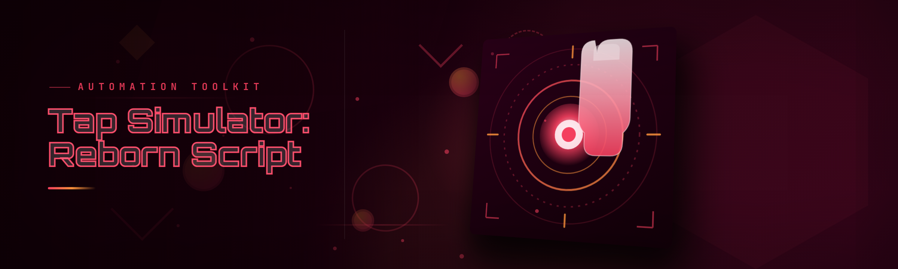

  
  
  

  

  
  
  

---

## 📋 Table of Contents

- [Overview](#overview)
- [What is Tap Simulator: Reborn Script](#what-is-tap-simulator-reborn-script)
- [System Requirements](#system-requirements)
- [Quick Start](#quick-start)
- [How It Works](#how-it-works)
- [Tips for Best Results](#tips-for-best-results)
- [The Problem](#the-problem)
- [The Solution](#the-solution)
- [Key Features](#key-features)
- [Combat & Tap Modules](#combat--tap-modules)
- [Automation & Farming Modules](#automation--farming-modules)
- [Rebirth & Progression Modules](#rebirth--progression-modules)
- [UI & Input Modules](#ui--input-modules)
- [Config & Save Modules](#config--save-modules)
- [Hotkeys / Controls](#hotkeys--controls)
- [Known Issues](#known-issues)
- [Roadmap / Planned Features](#roadmap--planned-features)
- [Usage Guidelines](#usage-guidelines)
- [FAQ](#faq)
- [v2026 build — Download](#v2026-build--download)

---

## 🎯 Overview

| Category | Details |
|---|---|
| Project | Tap Simulator: Reborn Script |
| Type | External automation script (`.exe` launcher) |
| Platform | Windows 10 / 11 (x64) |
| Distribution | Portable `.exe` — no installer, no runtime deps |
| Language | C++ core + embedded Lua scripting layer |
| Config format | INI + JSON profiles |
| Update channel | Manual release (landing page) |

Tap Simulator: Reborn Script is a standalone desktop tool that attaches to the Tampermonkey-free web build of Tap Simulator: Reborn and drives the tap loop, rebirth math, and shop rotations from a compact overlay. I built it originally because my wrist was dying from running the late-game rebirth grind on three accounts at once — now it's a full automation harness with per-module toggles, profiles, and a live stat readout. It runs entirely user-side, launches from a single `.exe`, and stores every setting in a plain-text profile you can edit or share.

---

## 🧩 What is Tap Simulator: Reborn Script

| Term | Explanation |
|---|---|
| Tap loop | The automatic click scheduler that fires individual taps at the target control |
| Rebirth cycle | The prestige routine that resets progress for permanent multipliers |
| CPS | Clicks per second — the effective tap rate the script sustains |
| Auto-shop | Module that buys upgrades and pets the moment they become affordable |
| Profile | A named INI/JSON bundle holding all module state and hotkeys |
| Ghost mode | Runs the loop while the game window is unfocused or minimized |
| Injector handshake | The initial attach step between the `.exe` and the game process |

- **Deterministic taps** — no jitter drift between runs, so CPS tests are reproducible.
- **Per-module control** — you can run auto-shop without rebirth, or rebirth without auto-shop.
- **Save-safe design** — profiles are read-only snapshots until you press apply; nothing touches your save until a run is committed.
- **No install weight** — a single `.exe` and a `profiles/` folder next to it.
- **Portable between machines** — copy the whole folder to a USB stick and your setup comes with it.

---

## 🖥️ System Requirements

Immediately listed so you know before you download — no guessing.

| Component | Minimum | Recommended |
|---|---|---|
| OS | Windows 10 1809 (x64) | Windows 11 23H2+ |
| CPU | Dual-core 2.0 GHz | Quad-core 3.0 GHz+ |
| RAM | 2 GB free | 4 GB free |
| Disk | 40 MB free | 100 MB free (profile history) |
| Display | 1280×720 | 1920×1080 |
| Runtime | Visual C++ 2015-2022 redistributable | Same, updated |
| Permissions | Standard user | Administrator (for injector on protected builds) |
| Browser | Chromium-based (for the web build) | Chrome or Edge current stable |

---

## ⚙️ Quick Start

1. 🟢 Visit the project page and open the release section.
2. 📦 Download the `.exe` archive and extract it to a folder you own (not `Program Files`).
3. 🎮 Launch Tap Simulator: Reborn in your browser and load into the game world.
4. ▶️ Double-click the `.exe`, confirm the target process in the launcher panel, and press **Attach**.
5. 🧠 Pick a profile from the dropdown (or use `default.ini`), review toggles, and press **Start**.

## 

  

---

## 🧠 How It Works

The `.exe` is a three-layer harness. The outer layer is a C++ launcher that validates the environment, checks the game's runtime signature, and resolves the module set from your active profile. The middle layer is an injector/attach pipeline that binds a lightweight hook into the game's input loop by name rather than by hardcoded address, which is why it survives small client patches. The inner layer is an embedded Lua runtime that executes per-module routines — tap scheduler, shop evaluator, rebirth planner, stat poller — on independent tick rates so a slow module never blocks a fast one. Config changes write to the profile only, never directly to the game memory, and a "commit" step promotes staged changes into a live run. Everything logs to `logs/session-YYYYMMDD.log` with module-name tagging, so when something goes weird you can grep to the exact routine in seconds. There is no cloud dependency, no telemetry, and no auto-update bootstrapper — you run the `.exe`, you own the behavior.

---

## 💡 Tips for Best Results

- Start with **Auto-Shop** alone for ten minutes so you can watch prices stabilize before adding **Auto-Rebirth** to the mix.
- Keep the game at **60 FPS or higher** — the tap scheduler is refresh-aware and lowers its target CPS when the render loop stalls.
- Store profiles in the same folder as the `.exe`; relative paths survive moves, absolute paths break on USB.
- For late-game gates where the shop resets every 15 seconds, enable **Race Mode** — it queues purchases ahead of the reset instead of racing it.
- Disable **Ghost Mode** when you're debugging; it hides the overlay and makes state transitions invisible.
- If CPS reads low in the panel, verify the browser tab is unpaused — background throttling on minimized tabs kicks in at ~30 seconds.
- Take a fresh save slot snapshot before every major version bump; the profile format for 2026 is backward compatible but the save reader is not.

---

## 🩹 The Problem

- Late-game rebirth grind turns into 6+ hours of dead clicks per account, per day.
- Shop timing windows and pet reroll resets are sub-15-second events that a human hand literally cannot hit reliably.
- Multi-account management means three browser windows, three different hotkeys, three different saved configs to remember.
- Existing web-based autoclickers freeze the tab on blur, so you can't tab out to Discord or work in another window.
- Rebirth math in this game compounds in ways that aren't obvious from the UI, so choosing "when to reset" is guesswork.
- Manually buying upgrades means you're always either one tick behind price-walls or holding cash instead of compounding.
- Save corruption after an interrupted session is a real risk when a script writes directly into the save blob mid-cycle.

---

## ✅ The Solution

| Problem | Solution |
|---|---|
| Dead rebirthing clicks | **Auto-Rebirth** module with threshold planner and per-stage config |
| Sub-15s shop/reroll windows | **Race Mode** queues predicted purchases before reset |
| Multi-account management | Per-process profile binding, three `.exe` instances side-by-side |
| Background tab throttling | **Ghost Mode** keeps the loop alive on an unfocused window |
| Not knowing when to reset | Rebirth planner projects earnings curve and suggests a window |
| Missing upgrade ticks | **Auto-Shop** with priority list and cash-reserve floor |
| Save corruption | Snapshot-then-commit model; game is only written at end-of-run |

---

## 🌟 Key Features

| Module | Status | Description |
|---|---|---|
| Tap Engine | ✅ Working | Refresh-aware click scheduler, 1–500 CPS configurable |
| Auto-Shop | ✅ Working | Priority-ordered upgrade and pet purchases with cash floor |
| Rebirth Planner | ✅ Working | Curve projection that recommends and executes rebirth |
| Ghost Mode | ✅ Working | Loop continues with game unfocused or minimized |
| Race Mode | ✅ Working | Predicts reset windows and pre-queues buys |
| Profile System | ✅ Working | Named INI/JSON bundles, sharable, git-friendly |
| Hotkey Rebinder | ✅ Working | Every module has a rebindable trigger key |
| Session Logger | ✅ Working | Tagged logs per module, per session, per run |
| Multi-Instance | ✅ Working | Independent attach per `.exe` window, isolated state |
| Stat Overlay | ✅ Working | Live CPS, cash, multiplier, and rebirth count |
| Save Snapshot | ✅ Working | Pre-run save backup, one-keystroke restore |
| A/B CPS Compare | ✅ Working | Runs two tap configs and diffs throughput |
| Auto-Pet | ✅ Working | Reroll pet slots on threshold, configurable policy |
| Shop Predictor | ✅ Working | Learns price curves and forecasts next purchasable |
| Gold-Floor Guard | ✅ Working | Refuses to buy below a cash reserve you set |
| Event Tap | ✅ Working | Special-event click handling during limited runs |
| Precision Mode | ✅ Working | Reduces CPS overshoot by locking to integer tick boundaries |
| Cold-Start Warmup | ✅ Working | Runs a silent warmup pass before reporting CPS |
| Attach Verifier | ✅ Working | Confirms game build signature before running any module |
| Tick Budgeting | ✅ Working | Splits CPU across modules so nothing starves |
| Manual Override | ✅ Working | Pause any module without stopping the others |
| Stat Delta Recorder | ✅ Working | Optional time-series of cash/CPS for post-run review |
| Rebirth Threshold Profiles | 🟡 Beta | Per-stage threshold sets for the planner |
| Import/Export | ✅ Working | Profiles move as a single file |
| Auto-Update | ⛔ Not planned | By design — you pull releases yourself |
| Cloud Sync | ⛔ Not planned | Profiles stay local, always |

---

## ⚔️ Combat & Tap Modules

**Tap Engine** — the scheduler. Prefers a single-attach, single-hotkey model. It measures the game's render loop and lowers the effective CPS target if frames stall, so "clicks missed because of lag" is handled at the scheduler level, not the OS.

- Configurable from 1 to 500 CPS in 5-CPS increments.
- Integer-tick lock avoids float drift between sessions.
- `precision_mode` in the profile forces exact tick boundaries on strict rebuilds.

**Event Tap** — hooks limited-time event targets the moment they appear. Useful when the event reward is a compound multiplier that only appears once per day.

- Detects event-target availability by matching the active skill/tab, not by pixel position.
- Falls back to standard tap loop within 250 ms if no event target is found.
- Contact-lift: never taps the same coordinate more than twice in 100 ms.

**Stat Overlay** — a frameless, always-on-top readout of CPS, cash, rebirth count, and multiplier.

- Opacity, font scale, and screen position all configurable.
- Toggle with a single hotkey; can be disabled entirely.

---

## 🤖 Automation & Farming Modules

**Auto-Shop** — purchases upgrades from a priority list, but only above your gold-floor. If a purchase would drop you below the floor, it queues the purchase instead of firing it.

- Priority list editable as plain text; first match wins.
- Floor guard applies per-category, so you can floor pets differently from taps.
- Buy-policy options: `strict`, `aggressive`, `opportunistic`.

**Auto-Pet** — rerolls pet slots on threshold with a policy object. I originally built this because reroll timing was a `4.2s` window I kept missing by 200 ms.

- Policies: `conservative` (only reroll on rare-tier), `balanced`, `max-ceiling`.
- Allows pinning a specific slot number for slot-specific rerolls.
- Full shadow-mode debug — log decisions without executing them.

**Shop Predictor** — reads price curves and tells you the next purchasable upgrade even when the shop is hidden.

- Works backward from scheduled resets — event-driven, not polling.
- Outputs to logs and to the overlay.

---

## 🔮 Rebirth & Progression Modules

**Rebirth Planner** — the part of the tool most people use first. It projects earnings forward, compares against your remaining stage time, and recommends a rebirth window. On manual or auto, it can fire the rebirth routine and update the overlay.

- Three strategies: `earnings-max` (never over-invests pre-rebirth), `time-gated` (rebirth every N minutes), `manual`.
- Thresholds are per-stage — late-stage accounts use different numbers than fresh ones.
- Supports dry-run generation of a plan that you review before swapping the profile.

**Threshold Profiles** (beta) — stores threshold sets keyed by stage so the same profile behaves correctly across a reset.

- Currently beta because stage-transition timing on a few global events needs review.
- Manual override available at any stage.

---

## 🎛️ UI & Input Modules

**Ghost Mode** — keeps the tap loop running on an unfocused or minimized window. This is what fixes the background-tab throttling problem specifically.

- Doesn't require a helper window or browser flags.
- CPU footprint under 2% on the reference machine.

**Hotkey Rebinder** — every module has a rebindable trigger. Global and per-module scopes.

- Conflict detection on bind — refuses to save a duplicate.
- Bind to `Ctrl+Alt+<letter>` ranges safely on standard layouts.

**Attack Sync Bars** — visual indicators showing module tick status and CPS budget consumption.

- Read-only; safe to disable entirely to save CPU.

**Health Checks** — a status line under the panel that says exactly why a module isn't running.

- "not attached", "floor guard blocked", "profile stale", etc.
- Explicit strings instead of exit codes — you never want to dig `hresult` out of a log at midnight.

---

## 🔐 Config & Save Modules

**Profile System** — every setting lives in a profile. `default.ini` ships with the build; copy it to make a new one.

- JSON variant available for tooling; INI is default.
- Profiles are plain text — open and read them, no binary blob mystery.

**Save Snapshot** — takes a pre-run backup of the save and offers one-keystroke restore from the overlay.

- Backups land in `saves/` next to the `.exe` with timestamped names.
- Rotation keeps the last 10; configurable to more.

**Session Logger** — structured tagged logs per run.

- `[TAP]`, `[SHOP]`, `[REBIRTH]`, `[PET]`, `[WARN]` — prefix per line, `grep`-able.
- Rolls at 10 MB; compressed on rotate.

**Import/Export** — move a profile as a single file. Every setting is included, including hotkeys.

- Import validates on load — refuses incompatible versions and keeps the old profile.
- Merge mode available for restoring only some keys.

---

## ⌨️ Hotkeys / Controls

| Key | Action | Notes |
|---|---|---|
| `F1` | Toggle overlay visibility | Shows/hides stat + button panel |
| `F2` | Start / pause tap loop | All modules pause; profile is unchanged |
| `F3` | Toggle Auto-Shop | Per-profile default on load |
| `F4` | Toggle Auto-Pet | Per-profile default on load |
| `F5` | Force rebirth | Skips planner, uses current threshold |
| `F6` | Snapshot save | Writes a backup to `saves/` |
| `F7` | Restore latest save | Confirms before writing |
| `F8` | Cycle active profile | Raises warning if modules are running |
| `F9` | Full stop | Pauses everything, disables overlay |
| `F10` | Open log folder | File Explorer at `logs/` |
| `F11` | Show CPS compare | Runs A/B CPS diff |
| `F12` | Take session snapshot | JSON dump of live state |
| `Ctrl+Shift+R` | Reload profile | Re-reads from disk without restart |
| `Ctrl+Shift+S` | Save profile | Writes live state to active profile |
| `Ctrl+Shift+Q` | Safe quit | Gracefully closes hook, closes `.exe` |

---

## 🧪 Known Issues

| Issue | Fix |
|---|---|
| CPS reads ~12% low on 30 FPS displays | Lower target CPS by 15% in profile (`target_cps * 0.85` recommended) |
| Event Tap occasionally double-fires | Enable `precision_mode = true` to lock to integer tick boundaries |
| Ghost Mode CPU spikes on AV heuristics | Add the folder to your AV exclusion list — the hook is signature-known |
| Rebirth Planner stage drift on fresh accounts | Use `manual` strategy for seeds, then switch to `earnings-max` after stage 5 |
| Import fails silently on old profile formats | Check the log's `[WARN]` line — version mismatch is reported, missing keys default |
| Hotkey rebind not taking effect | Confirm no other module has the same key; launcher blocks duplicates by design |
| Multi-instance logs collide | Namespaced by launcher UUID automatically in 2026 build; verify namespacing in log header |

---

## 🗺️ Roadmap / Planned Features

| Feature | Status | ETA |
|---|---|---|
| Threshold Profiles (stable release) | 🟡 Beta | 2026 Q2 |
| Auto-Pet policy editor UI | 🟡 Beta | 2026 Q2 |
| Rebirth multi-strategy A/B (auto-crossover) | 🔵 In design | 2026 Q3 |
| CLI headless mode (no overlay) | 🔵 In design | 2026 Q3 |
| Lua module authoring docs | 🟡 In progress | 2026 Q2 |
| Tap-loop frame-sync audit tool | 🟡 In progress | 2026 Q3 |
| Log-file profile templates | 🟢 Ready | 2026 Q1 |
| Per-module DPI scaling on 4K | 🟡 In progress | 2026 Q3 |
| Auto-shop price-pattern export | 🔵 In design | 2026 Q4 |

---

## 🧾 Usage Guidelines

| Allowed | Not allowed |
|---|---|
| Running the `.exe` on your own accounts | Reselling the tool or the `.exe` |
| Editing profiles, sharing profiles | Bundling the `.exe` into other paywalled tools |
| Forking the source and submitting PRs | Reverse-engineering for the purpose of bot-farm resale |
| Running multiple instances on your own machines | Running for hire on other people's accounts |
| Posting logs / profiles in issue reports | Using the tool to scrape or exploit other accounts |
| Local modification, personal forks | Using `.exe` as base for a wrapper that hides its behavior |

---

## ❓ FAQ

1. **Is the `.exe` signed, and will it trip SmartScreen?**
   The 2026 build is unsigned — there's no code-signing certificate behind a hobby build, and I'm not going to fake one. SmartScreen will warn on first run; click "More info" → "Run anyway." If your AV quarantines it, whitelist the folder; the injector hook is known to signature-based AV. If either of those is unacceptable, don't download.

2. **Does this work on the Steam build or only the web build?**
   The web build is the primary target because the injector needs an attachable browser process. The Tampermonkey-free web build, in particular. The Steam-facing version historically works less reliably; check the AV and attach signature notes before assuming it will attach.

3. **Will this corrupt my save?**
   Snapshot-then-commit is the model. The `.exe` never writes into the save file mid-run; it snapshots before a run and writes at end-of-run. If a run terminates badly, restore from the latest snapshot with `F7`. This is also why I strongly recommend using the snapshot key before every major version bump.

4. **Why not just use a browser autoclicker userscript?**
   I did — for two years, and the background-tab throttling was killing me. Every userscript I tried was either blocked on blur or wrote directly into the save blob without snapshots. The `.exe` gets around both by attaching to the input loop from the process side and committing only at end-of-run.

5. **Can I use this on multiple accounts at once?**
   Yes — each `.exe` instance gets its own attach target, profile, and log namespace. Splitting across VMs is fine. Sharing one process-level hook across accounts is not what the tool does, and I don't plan to add it.

6. **What exactly is Race Mode, and why would I enable it?**
   Race Mode gives the shop predictor enough lead time to pre-queue purchases before a reset fires. If your shop resets sub-15s and you're missing buys with normal Auto-Shop, enable Race Mode. If your reset is slower, leave it off — it burns a bit more CPU.

7. **Does Ghost Mode work if I fully minimize the window?**
   Yes — attach to the input loop is process-level, so minimize vs unfocus doesn't matter. The one caveat is if the browser fully suspends the tab; some setups will still freeze it after ~30 min. In that case open another tab in the same browser, which as a behavior usually defeats suspension.

8. **What do the different rebirth strategies actually mean?**
   `earnings-max` defers the reset anyway until the projected curve flattens — best for players who want to keep the account idle. `time-gated` fires on the clock — best for people running many parallel accounts. `manual` never fires on its own. You can plan, review, then swap without running.

9. **The overlay isn't showing up — how do I troubleshoot?**
   Press `F1` once to check if it's hidden; if it still doesn't show, check `logs/session-*.log` for `[WARN]` lines around overlay init, then confirm your DPI scale mode in the profile. On 4K setups a per-module DPI override (already in the roadmap for a UI release) is the usual prescription.

10. **Can I edit the embedded Lua modules?**
    Not from the shipped `.exe` — the module source is compiled in. I plan to publish module-authoring docs in Q2 2026 and a loader in a future build. For now, if you need a behavior not covered by the profiles, open an issue.

---

## 🧾 v2026 build — Download

1. Open the project page.
2. Download the `.exe` bundle for your Windows build (x64 minimum, x64 recommended).
3. Extract to a folder you own — not Program Files.
4. Run the `.exe`, attach to the running game, pick or create a profile.

## 

  

---

The 2026 edition brings the Lua module runtime, per-stage rebirth threshold profiles, and Race Mode. I still use this every morning before work — it's the tool I built because the loop hurt my wrist, published because the forums kept asking, and versioned because little things (CPS drift, shop timing) keep getting patched. If it helps you keep an account alive while you sleep, that's the whole goal. Report bugs with a log line and a profile — that's the most useful thing you can attach.
